# Drivewright: Car Dealership Inventory System

[](https://github.com/ArnavKataria550/Car-Dealership-Inventory-system/actions/workflows/ci.yml)

A full-stack web application for running a car dealership's inventory. Customers browse
and search the lot, open a car's details and buy it after a confirmation step; admins add,
edit, restock and remove listings and see every sale. It is built as a REST API (Node.js,
TypeScript, Express, PostgreSQL) and a React single-page app, developed test-first.

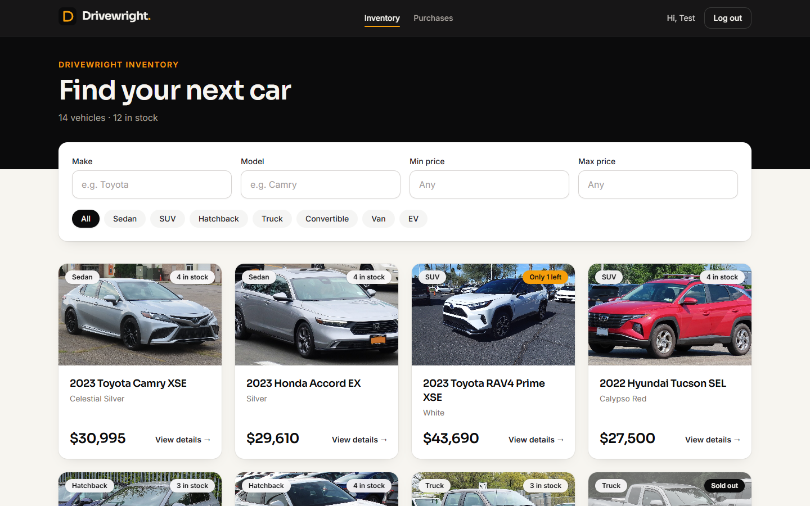

## Contents

- [Features](#features)
- [Tech stack](#tech-stack)
- [Architecture](#architecture)
- [Getting started](#getting-started)
- [Running the tests](#running-the-tests)
- [API reference](#api-reference)
- [Screenshots](#screenshots)
- [Design decisions](#design-decisions)
- [Project structure](#project-structure)
- [My AI Usage](#my-ai-usage)
- [Image credits](#image-credits)

## Features

**Customers**

- Register and log in (JWT, 1-hour sessions with automatic logout on expiry).
- Browse every vehicle as a grid of cards with photo, price and live stock.
- Search as you type by make and model, filter by category chips and a price range;
  filters live in the URL, so searches can be shared and the back button works.
- Open a vehicle's details page and buy it after a confirmation dialog. Sold-out cars show
  a disabled button; buying the last unit while someone else does is handled gracefully.
- See their order history on **My purchases**.

**Admins** (role assigned by the seed script, never by self-registration)

- Dashboard with listings, units in stock, sold-out count and stock value.
- Add and edit vehicles with live photo preview; only changed fields are sent.
- Restock (1 to 100 units at a time) and delete with confirmation, from the dashboard or
  directly from a car's card or details page.
- See **All purchases** with who bought what.

## Tech stack

| Layer    | Technology                                                                       |
| -------- | -------------------------------------------------------------------------------- |
| Backend  | Node.js, TypeScript, Express 5, Zod validation, JWT (jsonwebtoken), bcryptjs     |
| Database | PostgreSQL 16 via Prisma 7 (driver adapter `@prisma/adapter-pg`)                 |
| Frontend | React 19, Vite, Tailwind CSS v4, React Router, Inter and Sora fonts (Fontsource) |
| Testing  | Vitest + Supertest (backend), Vitest + React Testing Library + MSW (frontend)    |
| Tooling  | npm workspaces, ESLint, Prettier, GitHub Actions CI                              |

## Architecture

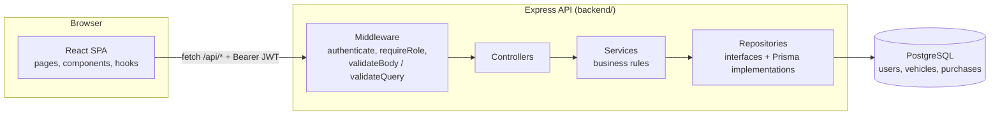

- **Layers with one job each.** Routes wire middleware and controllers; controllers
  translate HTTP to service calls; services hold the rules (who may see what, stock
  checks); repositories are interfaces with a Prisma implementation, so services are
  unit-tested against in-memory fakes.
- **Composition root.** `backend/src/container.ts` is the only place concrete classes are
  chosen; `createApp()` takes those dependencies, which keeps the app testable in-process.
- **One error shape.** Every failure is `{ "error": { "code", "message", "details?" } }`,
  produced by a single error handler.
- In development Vite proxies `/api` to the API, so the browser never needs CORS.

## Getting started

### Prerequisites

- **Node.js 22.12 or newer** (CI uses Node 24) and npm
- **PostgreSQL 14+** (developed on 16), running locally
- Git

### 1. Clone and install

```bash
git clone https://github.com/ArnavKataria550/Car-Dealership-Inventory-system.git
cd Car-Dealership-Inventory-system
npm install
```

### 2. Create the databases

Open `psql` as a superuser (on Windows, "SQL Shell (psql)" from the Start menu) and run,
choosing your own password:

```sql
CREATE ROLE dealership WITH LOGIN PASSWORD 'choose_a_password' CREATEDB;
CREATE DATABASE car_dealership OWNER dealership;
CREATE DATABASE car_dealership_test OWNER dealership;
```

The second database is used only by the test suite, so tests never touch your data.

### 3. Configure the backend

Copy [`backend/.env.example`](backend/.env.example) to `backend/.env` and fill it in:

| Variable                                   | What to set                                                         |
| ------------------------------------------ | ------------------------------------------------------------------- |
| `DATABASE_URL`, `TEST_DATABASE_URL`        | Replace `CHANGE_ME` with the password from step 2                   |
| `JWT_SECRET`                               | 32+ random characters (generate with the command in the file)       |
| `SEED_ADMIN_EMAIL` / `SEED_ADMIN_PASSWORD` | The admin account the seed script creates (password: 8+ characters) |

The API validates these on startup and refuses to start with a clear message if one is
missing or invalid.

### 4. Create the schema and load demo data

```bash
npm run db:generate -w backend
npm run db:deploy -w backend
npm run db:seed -w backend
```

The seed creates the admin account from your `.env` and 14 demo vehicles (two per
category, a couple of them sold out) with freely licensed photos. It can be re-run at any
time; it refuses to run when `NODE_ENV=production`.

### 5. Run the app

In two terminals:

```bash
npm run dev -w backend
```

```bash
npm run dev -w frontend
```

Open **http://localhost:5173**. Log in with the seeded admin, or create a customer account
on the register page. The API itself listens on http://localhost:4000 (`GET /api/health`).

### Production build

```bash
npm run build -w backend
npm run build -w frontend
```

`npm start -w backend` runs the compiled API from `backend/dist`, and the static frontend is
in `frontend/dist` (`npm run preview -w frontend` serves it locally with the `/api` proxy).

## Running the tests

| Command                                                       | What it does                                                           |
| ------------------------------------------------------------- | ---------------------------------------------------------------------- |
| `npm test`                                                    | Both suites (the backend migrates its test database automatically)     |
| `npm run test:coverage -w backend` / `-w frontend`            | One suite with a coverage report                                       |
| `npm run test:report`                                         | Both suites with coverage; writes [docs/test-report](docs/test-report) |
| `npm run lint` / `npm run typecheck` / `npm run format:check` | ESLint, TypeScript and Prettier checks                                 |

**Test report:** see [docs/test-report/README.md](docs/test-report/README.md) for the
latest results (383 tests, all passing; backend 99.6% line coverage, frontend 96.8%) and
the full list of test cases.

The backend suite runs real HTTP requests (Supertest) against a real PostgreSQL test
database, including concurrency tests that fire simultaneous purchases at the last unit.
The frontend suite drives the real app with Testing Library while MSW plays the API.
GitHub Actions runs lint, both test suites (backend against a Postgres 16 service with
coverage thresholds) and a production build on every push.

The project was built test-first: the commit history shows each feature as a failing
`test(...)` commit followed by the `feat(...)` commit that makes it pass, with
`refactor(...)` commits in between.

## API reference

All endpoints are under `/api`. Protected endpoints need `Authorization: Bearer <token>`
from the login response. Prices are integer cents (`2799900` = $27,999.00).

| Method & path                     | Access    | Body / query                                                              | Success                |
| --------------------------------- | --------- | ------------------------------------------------------------------------- | ---------------------- |
| `POST /api/auth/register`         | Public    | `{ name, email, password }` (password 8+ characters)                      | `201 { user }`         |
| `POST /api/auth/login`            | Public    | `{ email, password }`                                                     | `200 { token, user }`  |
| `GET /api/vehicles`               | Logged in |                                                                           | `200 { vehicles }`     |
| `GET /api/vehicles/search`        | Logged in | `?make=&model=&category=&minPriceCents=&maxPriceCents=` (all optional)    | `200 { vehicles }`     |
| `GET /api/vehicles/:id`           | Logged in |                                                                           | `200 { vehicle }`      |
| `POST /api/vehicles`              | Admin     | `{ make, model, category, year, color, priceCents, quantity?, imageUrl }` | `201 { vehicle }`      |
| `PUT /api/vehicles/:id`           | Admin     | Any subset of the create fields                                           | `200 { vehicle }`      |
| `DELETE /api/vehicles/:id`        | Admin     |                                                                           | `204`                  |
| `POST /api/vehicles/:id/purchase` | Logged in | `{ quantity? }` (default 1)                                               | `200 { vehicle }`      |
| `POST /api/vehicles/:id/restock`  | Admin     | `{ quantity }` (1 to 100)                                                 | `200 { vehicle }`      |
| `GET /api/purchases`              | Logged in | Customers get their own orders, admins every sale                         | `200 { purchases }`    |
| `GET /api/health`                 | Public    |                                                                           | `200 { status: "ok" }` |

Categories: `SEDAN`, `SUV`, `HATCHBACK`, `TRUCK`, `CONVERTIBLE`, `VAN`, `EV` (any letter
case is accepted). Search matches make and model partially and case-insensitively and
combines filters with AND.

Errors use `{ "error": { "code", "message", "details?" } }`: `400 VALIDATION_ERROR` (with
per-field `details`), `401 UNAUTHORIZED`, `403 FORBIDDEN`, `404 NOT_FOUND`,
`409 CONFLICT` / `409 INSUFFICIENT_STOCK`, `500 INTERNAL_ERROR`.

## Screenshots

**Desktop**

| Login                                                              | Search with filters                                            |
| ------------------------------------------------------------------ | -------------------------------------------------------------- |
| 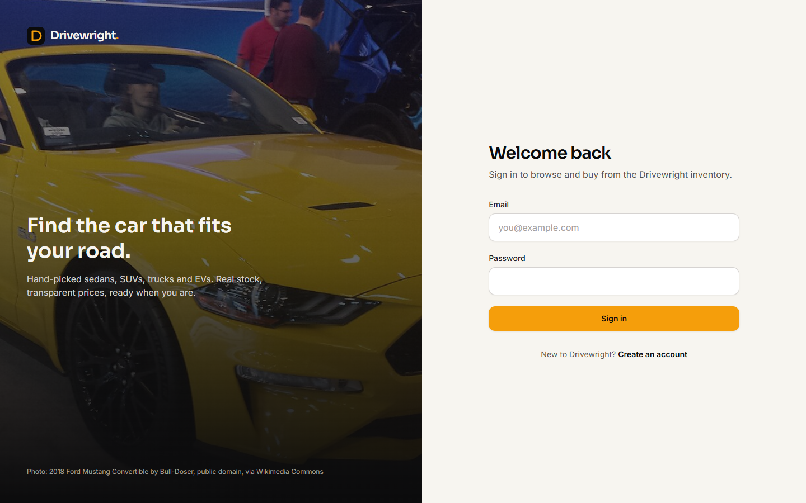                       | 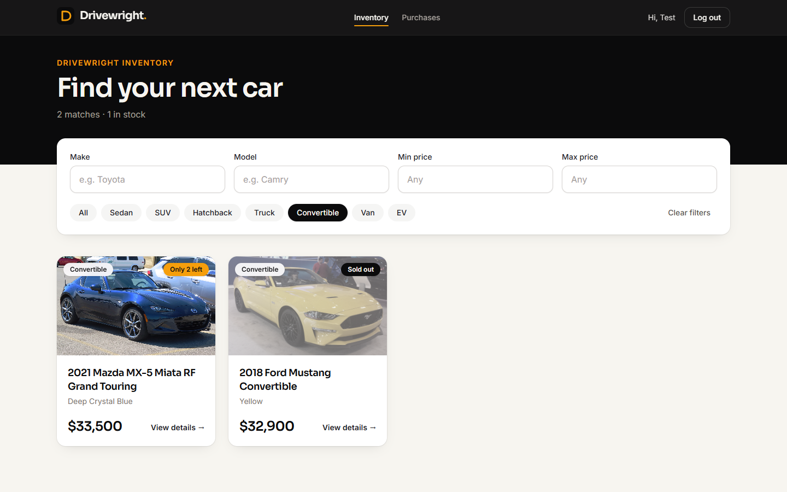         |
| **Vehicle details**                                                | **Purchase confirmation**                                      |
| 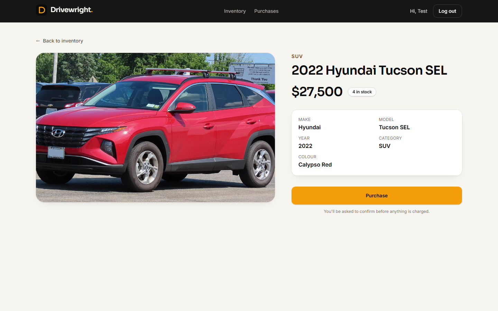           | 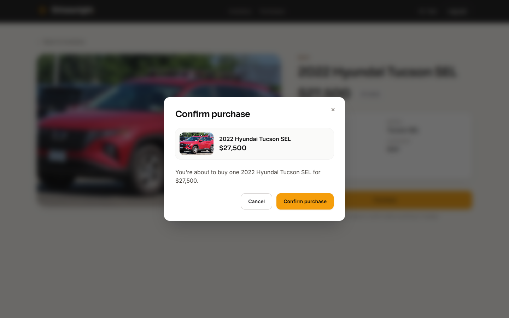 |
| **My purchases**                                                   | **Register**                                                   |
| 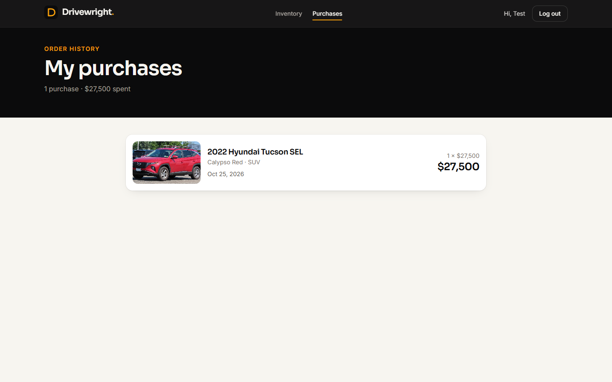         | 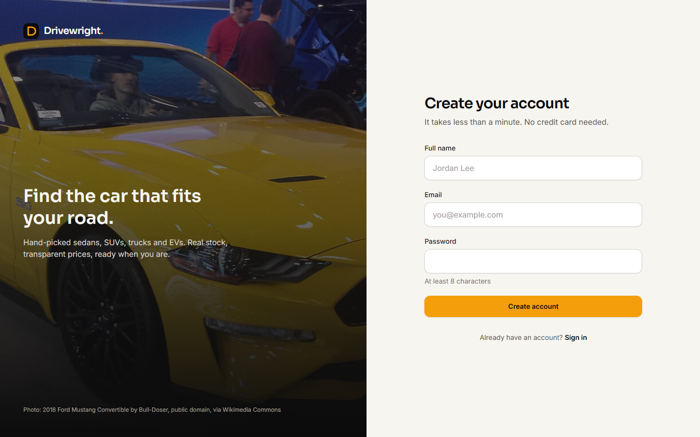             |
| **Admin dashboard**                                                | **Admin: edit with photo preview**                             |
| 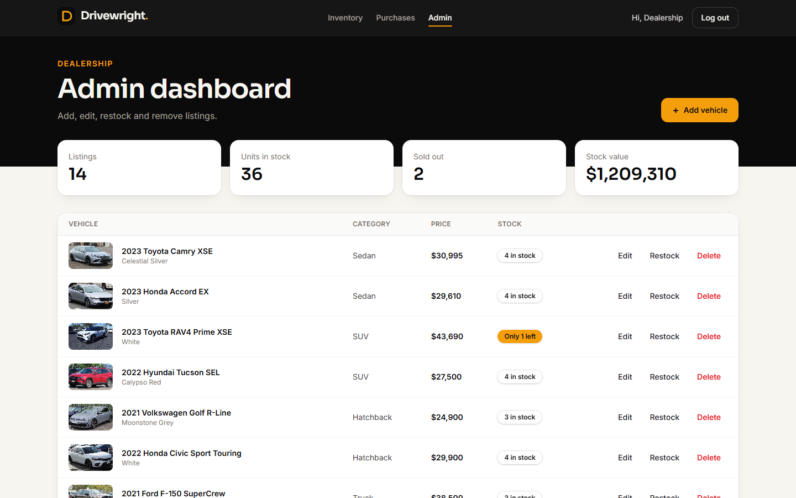             | 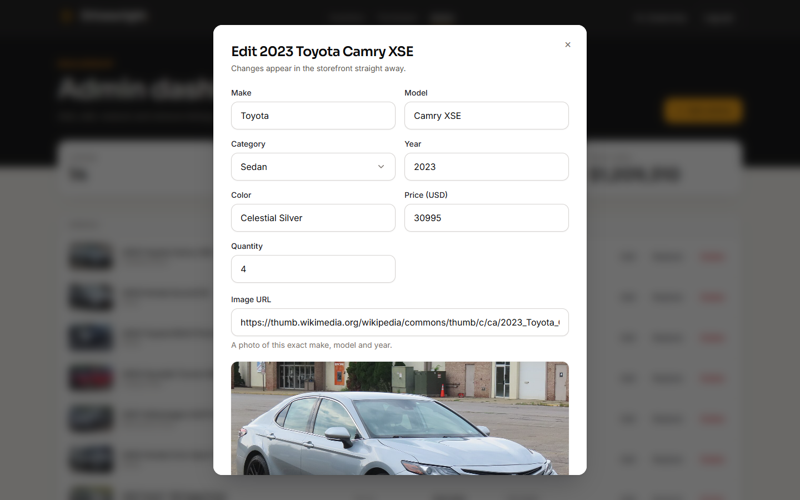       |
| **Admin: all purchases**                                           |                                                                |
| 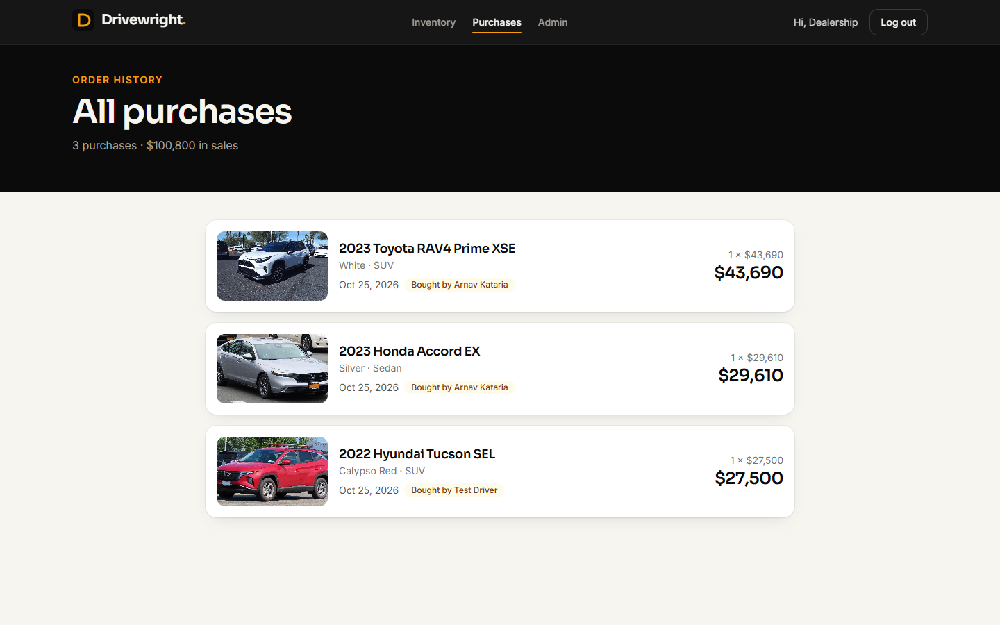 |                                                                |

**Phone**

| Login                                      | Inventory                                          | Details                                                | My purchases                                          |
| ------------------------------------------ | -------------------------------------------------- | ------------------------------------------------------ | ----------------------------------------------------- |
| 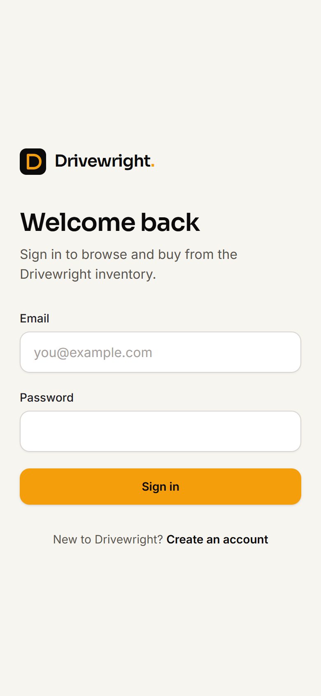 | 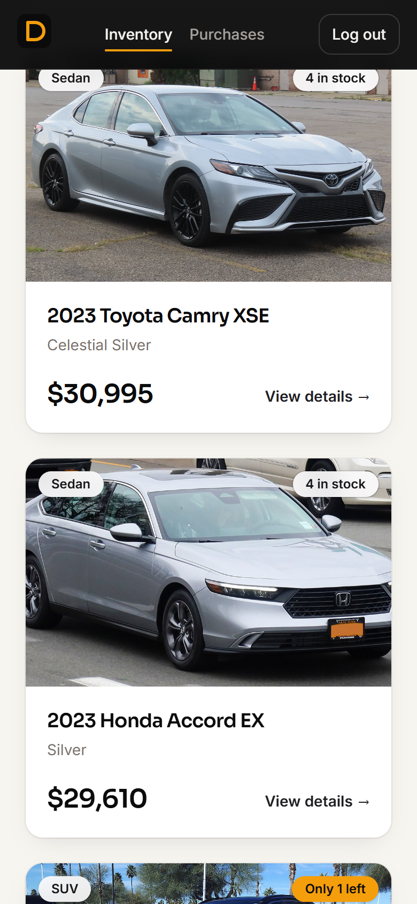 | 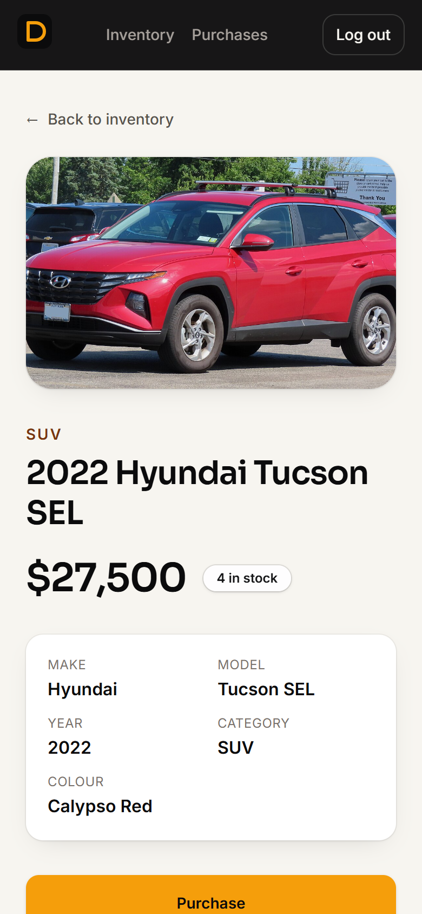 | 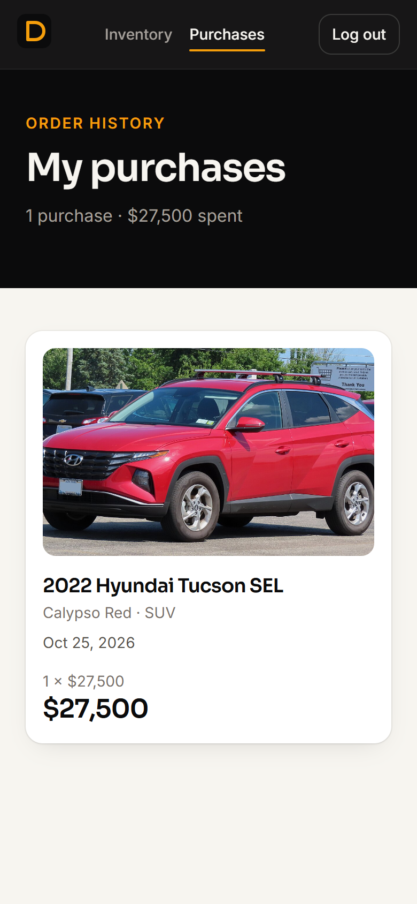 |

## Design decisions

- **Money in integer cents** end to end, so no floating-point rounding; the UI formats it.
- **No overselling.** A purchase is one conditional `UPDATE … WHERE quantity >= n` inside a
  transaction that also writes the purchase record, backed by a `CHECK (quantity >= 0)`
  constraint. Concurrency tests prove simultaneous buyers can't take the same last car.
- **Order history survives change.** Each purchase stores a snapshot of the car and the
  price paid, so edits or deleted listings never rewrite past orders.
- **Secure by default.** Everyone registers as a customer; login gives the same answer and
  timing for an unknown email and a wrong password; tokens are pinned to HS256; passwords
  are bcrypt-hashed; unexpected errors never leak internals.
- **Validation twice.** Zod schemas guard the API; the frontend mirrors the same rules for
  instant feedback and shows server errors next to the right field.
- **Design.** A car-marketplace look: ink black and off-white with one amber accent
  reserved for primary actions, rounded cards with soft shadows and gentle hover motion,
  responsive down to phone width, keyboard and screen-reader friendly (labelled fields,
  focus-trapped dialogs, live regions), and no animation for users who prefer reduced motion.

## Project structure

```
backend/
  prisma/            schema, migrations, seed entry point
  src/
    modules/         auth, vehicles, purchases (routes, controllers, services, repositories)
    middleware/      authenticate, requireRole, validation, errors, 404
    seed/            demo catalogue and seeding logic
  tests/             unit/ and integration/ suites, helpers
frontend/
  src/
    api/             typed API client and endpoint helpers
    auth/            session storage and AuthProvider
    components/      UI kit (Button, TextField, Modal, Toast, …) and layouts
    features/        vehicles, admin, purchases, auth forms
    pages/           one component per route
docs/                test report, screenshots, image credits
scripts/             test report generator
```

## My AI Usage

### Tools used

- **Claude** (Anthropic), used through **Claude Code**, as a pair-programming partner for
  the whole project. No other AI tools were used.

### How I used it

I set the requirements and made the decisions; Claude proposed a plan for each step,
asked about anything ambiguous, and then implemented it in small test-first commits that
I reviewed, tested and approved before they were pushed.

- **Planning.** Claude broke the brief into phases (tooling, auth, vehicles, inventory,
  frontend foundation, features, deliverables) and listed ambiguities as questions. I
  decided them, for example: admins only via the seed, admin-only create/update, prices in
  integer cents, a fixed category list, a 100-unit restock cap, live search, a details
  page with purchase confirmation, and purchase history with admins seeing all sales.
- **Test-driven implementation.** For every feature Claude wrote the failing tests first,
  committed them, then wrote the implementation and refactored, running the suites,
  typecheck and linting before each commit.
- **Debugging and verification.** It caught and fixed issues such as npm resolving the
  Prisma CLI to a release candidate, an MSW 3 option rename that silently disabled a test
  safety net, a Windows case-insensitive filename overwrite, and PowerShell mangling quotes
  in commit messages. It checked the UI in a browser at desktop and phone widths, which
  found real bugs (a navbar overflowing on phones, a select without its arrow).
- **Research.** It found the demo vehicle photos on Wikimedia Commons, checked each one's
  licence and that it shows the right make, model and year, and generated the credits.
- **Documentation.** It drafted this README, generated the test report and captured the
  screenshots.

### Transparency

- Every commit made with Claude ends with a `Co-authored-by: Claude` trailer, separated by
  two blank lines as the brief requires.
- [PROMPTS.md](PROMPTS.md) contains the raw, unedited transcript of the AI session.

### Reflection

Working on this project with Claude Code helped me understand how AI can make software development easier without replacing my own thinking. I decided the requirements and important things, and reviewed the changes before approving them. Claude helped me break the work into smaller phases and use TDD, where tests are written before the actual code. This helped me find issues early and understand why some features were not working properly.

I also learned that AI generated code still needs to be checked carefully. Testing in the browser showed some UI issues that automated tests didnt catch, and checking image licences taught me to be more careful with external resources. I reviewed commits and tested the application instead of blindly trusting every suggestion. This experience improved my debugging and planning skills. I still need to understand some implementation details better, but it showed me how useful AI can be when I take responsibility for the final result. It has made me more careful about building reliable software.

## Image credits

Demo vehicle photos come from Wikimedia Commons under free licences (CC BY-SA 4.0, CC0 or
public domain). See [docs/IMAGE_CREDITS.md](docs/IMAGE_CREDITS.md) for each photo's author
and licence.
